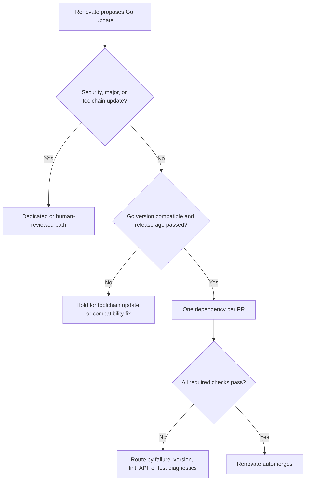

# EC-2275: Go dependency update process

**Purpose:** increase the number of safe Go minor and patch updates that merge,
while reducing routine human review work and keeping required checks as the
merge gate.

**Snapshot time:** 2026-11-18 03:03 UTC. Counts below are pull requests, not
unique dependencies. Renovate may open separate PRs for the same dependency on
main and multiple release branches, and these counts include security updates.

## Acceptance criteria status

| Acceptance criterion | Status | Evidence or remaining work |
|---|---|---|
| Current automated PR volume and age are documented. | Met | `ec-2275-baseline.md` records 81 open Renovate PRs, oldest ages by organization and Go update kind, and current repository queues as of 2026-11-18 03:03 UTC. |
| Go module, Go toolchain, Go image, grouped, security, and single-dependency updates are separately identified. | Met | The baseline separates update kind from module PR shape and identifies security as an overlapping subset. |
| Required-check failures are distinguished from optional or informational failures. | Met | The baseline records a 2026-11-17 check-context snapshot: 19 PRs with failed required checks and four with only non-required failed statuses. |
| Repositories with the largest actionable bottlenecks are identified. | Met | CLI has the largest Go queue and most failures in the Conforma sample; enterprise-contract-controller has six aged Go PRs failing required `Checks`; policy is next, and e2e-tests is a high-throughput comparison. |
| Findings and recommended priorities are recorded in Jira and linked to this epic. | Met | Jira comment on EC-2275 records the findings and priorities; EC-2275 is already linked under EC-2274. The supporting report and rollout plan are in `docs/ec-2275-baseline.md` and `docs/ec-2275-go-update-process.md`. |

## Where to focus

| Repository | Open Go-related Renovate PRs | Merged in the prior ~90 days | Signal |
|---|---:|---:|---|
| [cli](https://github.com/conforma/cli) | 27 | 11 | Largest current Go backlog. Sixteen of the 19 failed-required-check PRs in the Conforma sample were here. Start here. |
| [enterprise-contract-controller](https://github.com/enterprise-contract/enterprise-contract-controller) | 6 | — | All six aged Go PRs fail required `Checks` while `Analyze (go)` passes. Diagnose this common failure next. |
| [policy](https://github.com/conforma/policy) | 10 | 38 | High update volume and three of the 19 failed-required-check PRs in the Conforma sample. Start third. |
| [e2e-tests](https://github.com/conforma/e2e-tests) | 1 | 40 | High recent merge volume with little current backlog. Use as a comparison for validation and merge behavior. |
| [go-gather](https://github.com/conforma/go-gather) | 1 | 8 | Smaller queue and lower recent volume. |

In the earlier Conforma failed-check sample, CLI had 16 failures and policy
had 3; the other Conforma repositories did not account for those 19 failures.
The separate controller scan found six PRs with the same required-check
failure. The counts suggest CLI is the first bottleneck to relieve and the
controller is a focused follow-up. Policy is the next useful target, while
e2e-tests is a positive comparison. They do not establish relative failure
rates: update frequency, branch count, and security PRs affect the totals.

## Ordered rollout

### 1. Confirm the update policy

Use this automatic lane for stable, non-security Go module minor and patch
updates. Keep major updates, security updates, Go toolchain changes, and known
API-breaking updates on their existing manual or dedicated paths. Retain the
five-day minimum release age and all required checks.

### 2. Fix the Go-version validation bottleneck

The shared Go version checker currently requires each Go version it finds to
equal the running Go version. It checks every go.mod directive, .tool-versions
entry, and Dockerfile or Containerfile builder version. That exact comparison
accounted for 12 Test failures in the earlier sample.

Decide the intended contract before changing the check. The Go go.mod directive
is a minimum required version, so the recommended contract is that the running
toolchain must be at least that version. Keep exact matching for toolchain pins
such as .tool-versions and container builder images if lockstep is intentional.
If exact equality across all files is a deliberate policy, keep the check and
make Go version updates change all those files atomically instead.

Add focused checker coverage for: a running toolchain above a module minimum;
a running toolchain below a module minimum; different module minimums that are
both supported; and mismatched toolchain pins. The official [Go Modules
Reference](https://go.dev/ref/mod#go-mod-file-go) defines the go directive as a
minimum requirement.

### 3. Remove secondary validation failures

- Update the lint/type-check toolchain so it can read export data produced by
  the Go version used in CI.
- Keep compile and API checks strict. Isolate updates that trigger Cosign,
  structured-merge-diff, or Rekor API incompatibilities and either adapt the
  caller or hold that dependency update.
- Ensure policy's aggregate test job exposes the failing command and its
  diagnostics. Keep module sums tidy and add a CI check that detects stale
  go.mod/go.sum state.

### 4. Split broad Go module bundles

In CLI and policy, override the shared Renovate grouping rule for minor and
patch Go module updates so unrelated dependencies get separate PRs. Keep all
occurrences of the same dependency updated together. Retain a group only where
there is a demonstrated need for dependencies to move in lockstep. Keep
gomodTidy enabled.

This targets the failed bundles CLI #3669, #3131, and #3130, and policy #1686
and #1632. Renovate places updates with the same group name in one PR; without
that grouping, updates can pass independently. See [Renovate grouping
documentation](https://docs.renovatebot.com/configuration-options/#groupname).

### 5. Automate the eligible merge lane

Prefer Renovate's native automerge for eligible PRs over a bot-generated
APPROVED review. The current shared auto-merge workflow waits for a
collaborator's approval before it enables GitHub auto-merge. Configure the
non-security minor lane only after the split PRs are green, and verify the
Renovate app's existing ruleset bypass can be used without bypassing required
status checks. Keep majors, security updates, toolchain changes, and red or
diagnostic-poor PRs out of this lane.

Renovate waits for passing status checks by default. Keep the branch's required
checks configured, and do not enable an ignore-tests option. See [Renovate
automerge documentation](https://docs.renovatebot.com/key-concepts/automerge/).

### 6. Canary in CLI, then apply to policy

After the Go-version validation change, use one low-risk, non-security CLI
minor update to verify the whole path: independent PR creation, all required
checks, no human review event, and successful auto-merge. Confirm a failing
required check still blocks the merge. Then apply the same policy to policy.
Use e2e-tests to compare CI and merge behavior; do not assume its configuration
is identical.

### 7. Measure and widen gradually

For each repository, track over a fixed period:

- eligible Go PRs opened and merged;
- required-check pass rate and time to merge;
- human approvals or interventions;
- CI run volume and concurrent open PRs;
- reverts or follow-up fixes.

Keep the current PR concurrency cap during the pilot. If the green lane merges
reliably and the human queue shrinks, widen the update set. If CI load becomes
the limiter, adjust scheduling or concurrency based on those measurements.

## CLI implementation handoff

**Scope:** improve Go update throughput in conforma/cli first. Make the shared
Go-version checker change separately because other repositories consume it.
Do not change policy or organization rulesets as part of the CLI PRs.

### PR 1: make the shared Go-version check test compatibility

**Files:**

- Modify `conforma/github-workflows/golang-version-check/golang-version-check.sh`.
- Add `conforma/github-workflows/golang-version-check/test.sh`.
- After the shared-workflows PR is merged, update the action pin in
  `conforma/cli/.github/workflows/checks-codecov.yaml` to that commit.

**Steps:**

1. Add fixture tests that run the checker with a fake `go env GOVERSION` and a
   temporary repository. Cover a running toolchain above a module minimum, a
   running toolchain below a module minimum, multiple supported module
   minimums, and mismatched `.tool-versions` or container pins.
2. Run `bash golang-version-check/test.sh`; confirm the tests fail against the
   current equality behavior.
3. Change only go.mod validation to compare the running toolchain against the
   module minimum. Keep exact matching for `.tool-versions` and container pins
   unless the owner chooses a different pin policy.
4. Run the checker tests again. Confirm a too-old runtime still fails and the
   error annotation names the module and both versions.
5. Search for all consumers of the shared action. Check the revised behavior
   against CLI and at least one other consumer before merging the shared PR.
   From the shared-workflows checkout, use
   `rg -n 'golang-version-check@'` to find pinned consumers.
6. Update CLI's pinned action revision in `checks-codecov.yaml`; do not point
   the workflow at a moving branch.

**Gate:** do not proceed if an older-than-required runtime or an invalid
toolchain pin passes.

### PR 2: update the CLI linter for the CI Go version

**Files:**

- Update the golangci-lint dependency in `conforma/cli/tools/go.mod` and its
  corresponding `tools/go.sum` entry.
- Do not change `.golangci.yaml` rules to suppress the export-data failure.

**Steps:**

1. Select a golangci-lint release that supports the Go export-data version
   emitted by the CLI CI toolchain.
2. Run `make lint`. It invokes golangci-lint for the root module and
   `acceptance` module; both must pass.
3. Confirm the required `Lint` check passes on the PR.

**Gate:** if a candidate release still cannot read the Go export data, do not
merge it or suppress type-checking; select a compatible release.

### PR 3: split CLI Go module minor and patch updates

**File:** `conforma/cli/renovate.json`.

**Steps:**

1. Add a repository-level rule after the inherited configuration that removes
   grouping for Go module minor and patch updates.
   The rule should match manager `gomod`, update types `minor` and `patch`, and
   set `groupName` to `null`.
2. Leave major updates manual. Preserve the shared `gomodTidy` behavior and
   confirm vulnerability-alert updates retain their current dedicated path.
3. Run `npx --yes --package renovate -- renovate-config-validator` and inspect
   the resolved config to confirm the local rule overrides the inherited `go
   modules` group only for the intended update types.
4. Wait for Renovate to create independent PRs. Do not close existing grouped
   PRs until their individual replacements exist and their changed dependency
   versions are accounted for.

**Gate:** unrelated dependencies must not be bundled together. Confirm how
Renovate handles a dependency referenced from several go.mod files; if it splits
that one dependency into separate PRs, add a narrowly scoped group for those
copies only.

### PR 4: automate eligible CLI minor merges

Make this a separate PR after PR 3 has produced green independent updates.

1. Add native Renovate automerge for stable, non-security Go module minor
   updates. Keep the release-age delay and require every branch-required check
   to pass. Do not use an ignore-tests option.
2. Inspect the resolved Renovate config and PR body to confirm security alerts
   are not newly included in this minor-update lane.
3. Confirm the Renovate app's existing ruleset bypass supports the intended
   merge path. Do not broaden organization ruleset permissions as part of this
   PR; stop for an owner decision if existing permissions are insufficient.
4. Canary with one low-risk, non-security minor PR. Verify it merges after all
   required checks pass without a human approval event. Verify a failing
   required check remains blocking in a controlled test PR.

**Gate:** if the bot can merge while a required check is failing or pending,
disable the new automerge rule and resolve the ruleset/configuration issue.

### CLI handoff checklist

- [ ] Land the shared checker change and its fixture tests.
- [ ] Pin CLI's checker action to the merged shared-workflows commit.
- [ ] Update golangci-lint and pass `make lint` for both root and acceptance.
- [ ] Split Go module minor and patch updates in CLI Renovate config.
- [ ] Validate with `npx --yes --package renovate -- renovate-config-validator`.
- [ ] Review newly created PRs and verify one dependency is updated per PR.
- [ ] In a separate change, enable automerge for the approved minor lane and
      run the passing and failing canaries.
- [ ] Observe two weeks of results before making the same change in policy.

### CLI completion criteria

- The Go-version check accepts a toolchain that satisfies every module's Go
  minimum and still rejects an insufficient toolchain or mismatched exact pin.
- The `Lint` check handles the CI Go export-data format without suppressions.
- Minor and patch Go dependency PRs are independent and retain tidy module
  files.
- The canary proves passing eligible minors can auto-merge and failed required
  checks cannot.
- Record the first two weeks of merge rate, check failures, human
  interventions, CI volume, and reverts before widening the policy.

## Greenfield approach

For a new Go repository, establish the compatibility and automation rules
before the first Renovate backlog forms:

1. **Write down the Go support contract.** Choose the minimum Go version the
   code and dependencies may require, the toolchain used in CI, and the
   toolchain used for container builds. Treat each go.mod go directive as a
   minimum requirement; use exact equality only for pins that are meant to be
   identical. Test the minimum supported Go version and the pinned CI version.
2. **Make dependency updates small by default.** Create one PR per Go module
   update, including every occurrence of that module across the repository.
   Keep packages grouped only when they must be upgraded together. Run
   go mod tidy as part of update generation and check in CI that the module
   files remain tidy.
3. **Build a layered required-check set.** Run formatting, module-file
   validation, compile/type checks, unit tests, integration tests, and the
   relevant end-to-end checks. Keep failure output attached to the required
   check so a red PR identifies the failing command and diagnostic.
4. **Automate only a clearly defined green lane.** Enable native Renovate
   automerge for stable non-security minor and patch updates after the chosen
   release-age delay and only when every required check passes. Keep major,
   toolchain, security, and known compatibility-sensitive updates on separate
   paths. Do not create synthetic approval reviews.
5. **Keep bot permissions and merge rules aligned.** Give the Renovate app the
   permissions needed to request auto-merge, and verify the effective rules
   still require the intended CI checks. Prove both a passing PR can merge and
   a failing required check cannot merge before widening the policy.
6. **Measure the system from its first update.** Record update-to-green rate,
   merge time, CI cost, human interventions, and reversions. Use those results
   to tune the PR rate or concurrency cap rather than grouping unrelated
   updates to reduce notification volume.

The main greenfield difference is that dependency isolation and check-aware
automerge are the starting defaults. In an existing repository, those defaults
must be introduced gradually because current grouped PRs, version pins, and
branch rules already shape the backlog.

## Decision flow

## Current code and configuration references

- [Shared Renovate configuration](https://github.com/conforma/.github/blob/main/config/renovate/renovate.json)
- [CLI Renovate configuration](https://github.com/conforma/cli/blob/main/renovate.json)
- [Policy Renovate configuration](https://github.com/conforma/policy/blob/main/renovate.json)
- [Shared auto-merge workflow](https://github.com/conforma/github-workflows/blob/main/.github/workflows/auto-merge.yaml)
- [Shared Go version checker](https://github.com/conforma/github-workflows/blob/main/golang-version-check/golang-version-check.sh)

**Not done:** this is a rollout proposal; no Renovate, workflow, ruleset, or
test changes have been made. Validate ruleset behavior with the canary before
enabling automatic merges broadly.
